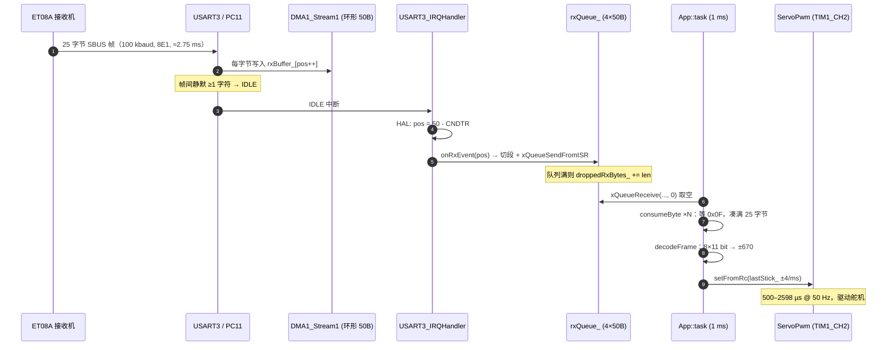

# ET08A / SBUS 数值接收全链路

> 目标：把「接收机输出的一串电平」逐级追到「`App::task()` 手里的一个 `int16_t` 杆量」，每一级都能落到仓库里的具体文件与行号。
> 范围：本仓库当前实现（`D:\ec_2027_submissions`，PinyTutorial 分支，STM32F407IGHX，FreeRTOS）。
>
> 结论先行：**USART3 + DMA 环形缓冲 + IDLE 中断切帧 → 4 段队列 → 1 ms 任务里按 `0x0F` 同步、25 字节拆 8×11 bit → 偏移成 ±670 的杆量 → 映射成 500–2598 µs 舵机脉宽**。

---

## 0. 一页速览

```
 ET08A 接收机
   │  SBUS：100000 baud，8E1（11 bit/字节），25 字节/帧
   ▼
 PC11 / USART3_RX ──► DMA1_Stream1（环形 50 字节）
   │                         │
   │                    帧间空闲 → IDLE 中断
   │                         ▼
   │              HAL 算出 DMA 写指针 pos（0..50）
   │                         ▼
   │              Bsp_uart 回调表 → ET08A::onRxEvent(pos)
   │                         ▼
   │              rxQueue_（4 段 × 50 字节，ISR→任务解耦）
   ▼                         ▼
                       App::task()（1 ms）
                         │  consumeByte：等 0x0F → 收满 25 字节
                         │  decodeFrame：拆 8 个 11 bit → int16
                         ▼
                       ServoPwm::setFromRc() → 500..2598 µs @ 50 Hz
```

| 关键数字 | 值 | 出处 |
| --- | --- | --- |
| 波特率 / 帧格式 | 100000 / 8E1（配置为 9B+偶校验） | `Src/Common/Soc/stm32f407ighx/hal/Core/Src/main.c:962-969` |
| 单帧长度 | 25 字节（0x0F + 22 字节通道 + flags + 0x00） | `Src/Common/Extensions/RemoteControl/ET08A/ET08A.hpp:12` |
| DMA 缓冲 | 50 字节 = 2 帧，循环模式 | `ET08A.hpp:13`、`stm32f4xx_hal_msp.c:1070-1085` |
| 解析节拍 | 1 kHz（`vTaskDelay(1)`，tick=1000 Hz） | `Src/App/AppManager.cpp:66-73`、`Src/Config/FreeRTOSConfig.h:32` |
| 在线判据 | 距上一帧 ≤ 100 ms | `ET08A.cpp:195-204` |
| 断线重挂 | 500 ms 节流 | `ET08A.cpp:58-93` |

---

## 1. 物理层：接收机 → 引脚 → USART3

### 1.1 接线

完整链路是：**遥控器（摇杆）—2.4 GHz 无线—► ET08A 接收机—SBUS 串口—► 芯片 PC11（USART3_RX）**。前一段是射频，MCU 完全看不到；本工程说的「串口接收」指的是后一段——接收机把解调出的 25 字节帧，按 100 kbaud、8E1 的格式从 SBUS 引脚发给芯片。

- 接收机 SBUS 信号 → **PC11（USART3_RX）**，`Src/Common/Soc/stm32f407ighx/hal/Core/Src/stm32f4xx_hal_msp.c:1057-1065` 把 PC11 复用为 AF7、`GPIO_SPEED_FREQ_VERY_HIGH`；PC10 是 USART3_TX（本链路不发，仅占位）。
- 接收机 5V 与 GND 必须共地；SBUS 是单线单向信号。
- 逻辑名 `SBUS_UART` 定义在 `Src/Common/Soc/stm32f407ighx/DefaultConf.hpp.in:3`：`#define SBUS_UART huart3`，应用层只认这个名字，换串口时改这里即可。

### 1.2 串口参数（CubeMX 生成）

`Src/Common/Soc/stm32f407ighx/hal/Core/Src/main.c:962-969`：

```c
huart3.Instance          = USART3;
huart3.Init.BaudRate     = 100000;
huart3.Init.WordLength   = UART_WORDLENGTH_9B;
huart3.Init.StopBits     = UART_STOPBITS_1;
huart3.Init.Parity       = UART_PARITY_EVEN;
huart3.Init.Mode         = UART_MODE_RX;
huart3.Init.HwFlowCtl    = UART_HWCONTROL_NONE;
huart3.Init.OverSampling = UART_OVERSAMPLING_16;
```

### 1.3 为什么是「9B + 偶校验」

STM32 的 `WordLength` **把校验位算在字数里**：

- `9B + EVEN` = 8 个数据位 + 1 个校验位 = SBUS 的 **8E1**；
- 若写 `8B + EVEN`，实际只剩 7 个数据位，收到的字节全部错位。

DMA 按**字节**搬运（`PeriphDataAlignment = DMA_PDATAALIGN_BYTE`，`stm32f4xx_hal_msp.c:1070-1085`），只取 DR 的低 8 位，校验位不进入内存 —— 所以 `rxBuffer_` 里就是干净的 8 位数据，和普通串口完全一样。

### 1.4 DMA 与中断优先级

| 项目 | 配置 | 位置 |
| --- | --- | --- |
| DMA 流/通道 | DMA1_Stream1 / Channel 4 | `stm32f4xx_hal_msp.c:1070-1085` |
| 方向 / 自增 | PERIPH_TO_MEMORY，MINC | 同上 |
| 模式 | **DMA_CIRCULAR**（关键） | 同上 |
| FIFO | 关闭（直通） | 同上 |
| USART3 中断优先级 | 5 | `stm32f4xx_hal_msp.c:1088-1089` |
| DMA1_Stream1 优先级 | 5 | `main.c:1029` |
| FreeRTOS 系统调用上限 | `configLIBRARY_MAX_SYSCALL_INTERRUPT_PRIORITY = 5` | `Src/Config/FreeRTOSConfig.h:97` |

优先级 5 正好等于 FreeRTOS 的门槛值（数值 ≥5 才允许调用 `...FromISR` API）。**如果谁把 USART3 提到 0–4，`xQueueSendFromISR()` 会触发断言**——这是本链路最容易踩的隐性约束。

---

## 2. 启动链路：调度器启动前就把 DMA 挂上

调用顺序（`Src/PinyCore.cpp:25-32` → `Src/App/AppManager.cpp:44-58`）：

```
initPinyCore()
└─ PinyCore::coreInit()
   ├─ AppManager::initApp()
   │  ├─ App::init()                       // Src/App/App.cpp:18-31
   │  │  ├─ receiver_ = make_unique<ET08A>(&SBUS_UART)
   │  │  ├─ (void)receiver_->start()       // 建队列、注册回调、挂 DMA
   │  │  ├─ lxServo_ = make_unique<ServoPwm>(&htim1, TIM_CHANNEL_2)  // → PE11
   │  │  └─ lxServo_->init()               // 1 µs 计数、20 ms 周期
   │  └─ AppManager::schedule(App::task)
   └─ vTaskStartScheduler()                // 之后 App::task 才开跑
```

`ET08A::start()`（`Src/Common/Extensions/RemoteControl/ET08A/ET08A.cpp:30-56`）：

1. `xQueueCreateStatic(RX_QUEUE_LENGTH=4, sizeof(RxChunk_s), ...)` —— 静态分配，无堆；
2. `uart_.registerCallback(...)` —— 把本对象的回调挂进 BSP 的分发表；
3. `uart_.registerRxRestartCallback(...)` —— 出错重启时通知「DMA 指针已归零」；
4. `uart_.receiveDma(rxBuffer_, 50)` —— 挂 DMA 并开 IDLE 中断。

`receiveDma` 失败会把 2、3 步注册的回调反注册、并把 `rxQueue_` 句柄置空（`ET08A.cpp:45-51`，静态存储不释放）；但 `App::init()` 用 `(void)` 忽略了 `start()` 的返回值（`Src/App/App.cpp:21`），所以**接收链路启动失败不会打日志**——真出问题时只能靠 `rxEvents/frames` 全 0 判断。舵机 `init()` 的失败则会 `LOG::error`（`App.cpp:25-29`）。

> **注意**：DMA 在 `vTaskStartScheduler()` **之前**就已挂载。若此时接收机已在发帧，ISR 会正常进 `onRxEvent` 并入队（队列已建好），数据不会丢；任务要等调度器启动后才开始消费。

`receiveDma()` 的实现（`Src/Common/Bsp/Uart/Bsp_uart.cpp:142-147`）：

```cpp
HAL_UARTEx_ReceiveToIdle_DMA(huart_, buf, len);
__HAL_DMA_DISABLE_IT(huart_->hdmarx, DMA_IT_HT);   // 关半传输中断
```

关掉 HT 中断是刻意的：半个缓冲（25 字节）没有语义，只有 **IDLE（一帧结束）** 和 **TC（缓冲满）** 才值得通知上层。

---

## 3. 中断链路：一帧数据如何进入队列

### 3.1 IDLE 是怎么算出来的

USART3 中断入口：`Src/Common/Soc/stm32f407ighx/hal/Core/Src/stm32f4xx_it.c:296-301` → `HAL_UART_IRQHandler(&huart3)`。

HAL 在 `Src/Common/Soc/stm32f407ighx/hal/Drivers/STM32F4xx_HAL_Driver/Src/stm32f4xx_hal_uart.c:2484-2534` 处理 IDLE：

```c
uint16_t nb_remaining_rx_data = (uint16_t)__HAL_DMA_GET_COUNTER(huart->hdmarx);
...
huart->RxXferCount = nb_remaining_rx_data;
if (huart->hdmarx->Init.Mode != DMA_CIRCULAR) { ...停 DMA... }   // 本工程是 CIRCULAR，跳过
HAL_UARTEx_RxEventCallback(huart, (huart->RxXferSize - huart->RxXferCount));
```

三条推论：

1. 回调参数 `Size = 50 - CNDTR` = **DMA 当前写指针（0..50）**，不是「本次收到多少字节」；
2. 因为 DMA 是循环模式，HAL **不停 DMA、不清 DMAR、不复位指针**，下一帧继续往后写；
3. 写满 50 字节时（`remaining == RxXferSize`，`stm32f4xx_hal_uart.c:2539-2555`）会补发一次 `Size = 50`，把「正好跨缓冲末尾」的情况也覆盖掉。

IDLE 的触发条件是「接收线空闲 ≥ 1 个字符时间」。100 kbaud、11 bit/字节 ⇒ 约 **110 µs** 的帧间静默就足以触发。

### 3.2 回调分发

`Bsp_uart.cpp:149-157` 用一个静态 `vector` 表按 `huart_` 指针查回调，找到后转调 `ET08A::onRxEvent(huart, pos)`。这里没有虚函数、没有动态分配，ISR 里是 O(小常数) 的查表。

### 3.3 环形指针三分支

`ET08A.cpp:220-246` 维护 `lastRxPosition_`（上一次已入队到的写指针），按三种情况切段：

| 情况 | 含义 | 动作 | 新 `lastRxPosition_` |
| --- | --- | --- | --- |
| `pos == 50` | 缓冲刚好写满 | 入队 `[last, 50)` | 0 |
| `pos < last` | 发生了回绕 | 入队 `[last, 50)` + `[0, pos)` | `pos` |
| 其它 | 正常前进 | 入队 `[last, pos)` | `pos` |

同时：`rxEventCount_++`、`receivedByteCount_ += 增量`（按环形差值累加，回绕时是 `50 - last + pos`）、最后 `portYIELD_FROM_ISR()` 让任务尽快运行。

**举例**：帧周期 14 ms、帧长 2.75 ms，缓冲 50 字节 ≈ 2 帧。多数时候 `pos` 从 25 走到 50（`pos==50` 分支）或从 0 走到 25（正常分支），回绕分支只在「恰好跨过 50 边界」时出现。三个分支覆盖了所有情形，不会重复计数。

### 3.4 入队与背压

`ET08A.cpp:248-263`：

- 把 `[start, end)` 拷进一个 `RxChunk_s`（定长，最多 50 字节）；
- `xQueueSendFromISR(rxQueue_, &chunk, ...)`；
- 队列满（4 段都没被任务取走）→ `droppedRxBytes_ += len`，不阻塞 ISR。

队列深度 4 的含义：任务被更高优先级打断或短暂阻塞时，仍能扛住约 4 段（≈2–4 帧）的突发；超过就丢字节并计数，方便定位「任务饿死」。

### 3.5 出错路径：ORE / FE / NE / PE

`Bsp_uart.cpp:169-201` 的 `HAL_UART_ErrorCallback`：

1. 按位检查 `ORE`（溢出）、`FE`（帧错）、`NE`（噪声）、`PE`（校验错）并清标志；
2. 若该串口注册过接收回调，重新 `HAL_UARTEx_ReceiveToIdle_DMA(huart->pRxBuffPtr, RxXferSize)` —— **从缓冲基址重新开始**；
3. 重启成功才 `notifyRxRestart()` → `ET08A::onRxRestart()` 把 `lastRxPosition_` 清 0（`ET08A.cpp:214-218`）。

这里有一个隐式顺序契约：**先重启 DMA，再通知上层归零**。若顺序反了，ISR 可能在上层归零前又写进一段，导致重复入队或漏字节。

> 校验位不匹配（比如接收机其实是 8N1，而 MCU 配成 8E1）会表现为：**每个字节都触发 PE** → 错误回调疯狂重启 → `rxEvents` 有增长但 `receivedFrames` 恒为 0。这是排查「有波形、没数据」的第一嫌疑。

---

## 4. 任务链路：字节流 → 帧 → 数值

### 4.1 1 ms 节拍

`Src/App/AppManager.cpp:66-73`：

```cpp
while (true) {
    for (auto &task : this->tasks) {
        task();
    }
    vTaskDelay(1);          // tick = 1000 Hz ⇒ 1 ms
}
```

`AppTask` 优先级 `HIGH1`、栈 512（`Src/App/AppManager.hpp:17`）。`App::task()` 见 `Src/App/App.cpp:33-79`。

### 4.2 取队列

`ET08A::processRxQueue()`（`ET08A.cpp:175-185`）用 `xQueueReceive(..., 0)` **非阻塞**地把当前所有段取空，逐段喂给 `consumeBytes()`。

### 4.3 帧同步状态机

`ET08A.cpp:265-315` 的 `consumeBytes/consumeByte`：

```
未在收帧：
  逐字节找 0x0F（帧头）→ 找到就进入“收帧中”，framePosition_ = 1
收帧中：
  每来 1 字节存入 frame_[framePosition_++]
  framePosition_ == 25 → decodeFrame(frame_)
      成功 → 临界区写 data_、lastFrameTick_ = now、receivedFrameCount_++
      失败 → 在 frame_[1..24] 里找下一个 0x0F，memmove 把尾巴挪到帧首，重新同步
```

因为帧头 `0x0F` 也可能出现在通道数据里，同步逻辑必须能「退半步重找」。**但当前 `decodeFrame()` 只检查 `frame_[0] == 0x0F`，而这个条件在进入时必然成立，所以它永远返回 true —— 重同步分支实际是死代码**（详见第 9 节）。

### 4.4 位域拆包

`ET08A.cpp:317-345`，`f[n]` 即 `frame_[n]`。SBUS 把 16 个通道按 11 bit 连续打包进 22 字节，本工程只取前 8 个（`f[1]..f[11]`）：

```c
ch[0] = (f[2]  << 8  | f[1])                & 0x7FF;
ch[1] = (f[3]  << 5  | f[2]  >> 3)          & 0x7FF;
ch[2] = (f[5]  << 10 | f[4]  << 2 | f[3] >> 6) & 0x7FF;
ch[3] = (f[6]  << 7  | f[5]  >> 1)          & 0x7FF;
ch[4] = (f[7]  << 4  | f[6]  >> 4)          & 0x7FF;
ch[5] = (f[9]  << 9  | f[8]  << 1 | f[7] >> 7) & 0x7FF;
ch[6] = (f[10] << 6  | f[9]  >> 2)          & 0x7FF;
ch[7] = (f[11] << 3  | f[10] >> 5)          & 0x7FF;
```

逐字节归属（低→高，便于用逻辑分析仪按字节对照）：

| 字节 | 承载的位 |
| --- | --- |
| f1 | ch1[0:7] |
| f2 | ch1[8:10] + ch2[0:4] |
| f3 | ch2[5:10] + ch3[0:1] |
| f4 | ch3[2:9] |
| f5 | ch3[10] + ch4[0:6] |
| f6 | ch4[7:10] + ch5[0:3] |
| f7 | ch5[4:10] + ch6[0] |
| f8 | ch6[1:8] |
| f9 | ch6[9:10] + ch7[0:5] |
| f10 | ch7[6:10] + ch8[0:2] |
| f11 | ch8[3:10] |

（表中 chN 指 SBUS 第 N 通道，对应代码里的 `channels[N-1]`；位序是「先到先占低位」的连续位流，与 SBUS 规范一致。）

f12–f22 是 ch9–ch16，本工程未解析；f23 是标志字节（failsafe / frame lost），f24 是帧尾，均未使用。

### 4.5 通道映射（本工程的实际接线顺序）

`ET08A.cpp:334-341` 的赋值决定了「SBUS 第几通道 → `RcData_s` 的哪个字段」：

| SBUS 通道 | 位域变量 | 输出字段 | 公式 | 说明 |
| --- | --- | --- | --- | --- |
| ch1 | ch[0] | `data_.ch0` | `ch[0] - 1024` | 正常 |
| ch2 | ch[1] | `data_.ch1` | `1024 - ch[1]` | **反向** |
| ch3 | ch[2] | `data_.ch3` | `ch[2] - 1024` | 与 ch4 互换 |
| ch4 | ch[3] | `data_.ch2` | `ch[3] - 1024` | 与 ch3 互换 |
| ch5 | ch[4] | `data_.SB` | `decodeSwitch()` | 三档开关 |
| ch6 | ch[5] | `data_.SD` | `decodeSwitch()` | 三档开关 |
| ch7 | ch[6] | `data_.wheel` | **原始值 0..2047** | 未减 1024 |
| ch8 | ch[7] | `data_.SA` | `decodeSwitch()` | 三档开关 |

也就是说：**`App` 里 `STICK_CHANNEL = 2` 实际取的是 SBUS 第 4 通道**。这是按这台遥控器/接收机的实际通道顺序写的，换设备必须重新核对（第 9 节列为待确认项）。左摇杆两个轴走这条映射的完整链路见 §5.4。

---

## 5. 数值语义

### 5.1 偏移、量程、三档开关

`ET08A.hpp:15-19`：

```cpp
static constexpr uint16_t CH_VALUE_MIN    = 353;
static constexpr uint16_t CH_VALUE_OFFSET = 1024;
static constexpr uint16_t CH_VALUE_MAX    = 1694;
enum class Sw_e : uint16_t { UP = 353, MID = 1024, DOWN = 1694 };
```

- 原始 11 bit 范围 0..2047，名义中位 1024；
- 减 1024 后，杆量落在 **−671 .. +670**（353−1024=−671，1694−1024=+670）；
- 三档开关判定（`ET08A.cpp:347-356`）：`< 689 → UP`，`< 1359 → MID`，否则 `DOWN`，即中位带为 **1024 ± 335**；
- `CH_VALUE_MIN/MAX` 目前只用于语义表达，**解码路径没有做限幅**（第 9 节）。

### 5.2 一个数值的旅程

以「摇杆推到一端」为例，同一条数值在每一级的样子：

| 层级 | 变量 / 表达式 | 数值 |
| --- | --- | --- |
| 空中 11 bit | `ch[0]` | 1694 |
| 去偏移 | `ch[0] - 1024` | +670 |
| 结构体快照 | `data_.ch0` | +670 |
| 选杆 + 限斜率 | `lastStick_` | +670（稳态） |
| 脉宽 | `setFromRc(670)` | 1550 + 670×(2598−1550)/670 = **2598 µs** |
| 物理 | TIM1_CH2 高电平 | 2.598 ms / 20 ms |

反向一端：353 → −671 → 脉宽 `1550 + (−671)×(1550−500)/671` = **500 µs**。中位：1024 → 0 → **1550 µs**。

`ServoPwm::setFromRc()` 见 `Src/Common/Extensions/Servo/ServoPwm.cpp:83-102`，常量见 `ServoPwm.hpp:17-22`。

### 5.3 时序预算（一帧从线上到舵机）

| 阶段 | 典型耗时 | 依据 |
| --- | --- | --- |
| 25 字节传输 | 2.75 ms | 25 × 11 bit ÷ 100 kbaud |
| 最后停止位 → IDLE 判定 | ≈110 µs | 1 个字符时间 |
| ISR 切段 + 入队 | < 10 µs | 一次 memcpy(≤50B) + 队列操作 |
| 等下一次 1 ms 任务节拍 | 0–1 ms | `vTaskDelay(1)` |
| 解析 25 字节 | 几 µs | 纯整数运算 |
| **合计（帧尾到杆量更新）** | **≈1.1 ms 最坏** | — |

叠加 SBUS 帧周期（常见 7–14 ms），端到端刷新率就是 **70–140 Hz**，远高于舵机 50 Hz 的刷新需求。

### 5.4 补充：操控左摇杆时的完整链路

左摇杆有两个轴。按 Mode 2 的常见通道顺序（AETR：ch1 副翼、ch2 升降、ch3 油门、ch4 方向），左摇杆落在 **ch3 / ch4**；代码里 `data_.ch2 = channels[3]`、`data_.ch3 = channels[2]` 的赋值顺序，也正是「左横、左纵」的排布（`ET08A.cpp:334-341`）。

| 左摇杆动作 | 物理通道 | 参与拆包的字节 | 解码中间量 | 输出字段 | 当前固件是否消费 |
| --- | --- | --- | --- | --- | --- |
| 左右（方向舵） | ch4 | f5、f6 | `channels[3]` | `data_.ch2 = channels[3] - 1024` | **是**（`STICK_CHANNEL = 2`） |
| 上下（油门） | ch3 | f3、f4、f5 | `channels[2]` | `data_.ch3 = channels[2] - 1024` | 否，只经 `readRcData()` 暴露 |

```
左手拇指
  │
  ├─ 左右（ch4 / 方向舵）
  │     └─► SBUS f5..f6 ─► channels[3] ─(−1024)─► data_.ch2 ──┐
  │                                                            │ STICK_CHANNEL = 2
  │                                                            ▼
  │                                                     App::task()（1 ms）
  │                                                            │ 每毫秒 ±4 限斜率
  │                                                            ▼
  │                                              ServoPwm 输出 500 / 1550 / 2598 µs 脉宽
  │
  └─ 上下（ch3 / 油门）
        └─► SBUS f3..f5 ─► channels[2] ─(−1024)─► data_.ch3 ──►（无读取者，到此为止）
```

图中 `ServoPwm` 那一行的 500/1550/2598 µs 是**舵机脉宽**：左横打到最左、正中、最右时，`setFromRc()` 分别输出 500 µs、1550 µs、2598 µs（对应 `data_.ch2` = −671、0、+670）。这条支路只由 `data_.ch2` 驱动；左纵一路走到 `data_.ch3` 就没有读取者了，不会产生脉宽。

**逐级数值（左摇杆打到最左 / 最右）**：

| 左摇杆位置 | `channels[3]`（原始 11 bit） | `data_.ch2` | `lastStick_`（稳态） | `setFromRc()` 脉宽 |
| --- | --- | --- | --- | --- |
| 最左 | 353 | −671 | −671 | 500 µs |
| 中位 | 1024 | 0 | 0 | 1550 µs |
| 最右 | 1694 | +670 | +670 | 2598 µs |

左纵（ch3）同理，只是结果落在 `data_.ch3`，当前没有执行器读取它。

**一次「从正中猛推到端点」的时间线**：

| 阶段 | 耗时 | 说明 |
| --- | --- | --- |
| 接收机采样并发出该帧 | 0–14 ms | 帧周期 7–14 ms（一帧本身占 2.75 ms 传输时间） |
| 帧尾静默 → IDLE 判定 | ≈110 µs | 1 个字符时间 |
| 等下一个 1 ms 节拍 + 解析 | 0–1 ms | `App::task()` |
| **摇杆动 → `data_` 更新** | **≈1–15 ms（平均半帧）** | 取决于动作发生在帧周期的哪个时刻 |
| 限斜率：0 → ±670 | **≈168 ms** | 670 ÷ 4 count/ms，只有大跳变才成为瓶颈 |
| PWM 生效 | ≤20 ms | 50 Hz 舵机周期 |

结论：**小幅、连续地推杆时，端到端延迟 ≈ 帧周期 + 1.1 ms（约 8–15 ms）**；只有从中位一把推到端点，才会看到 168 ms 的限斜率拖尾——这正是 `STICK_SLEW_STEP` 的目的：不让舵机吃阶跃指令。

**几个容易踩的点**：

1. **通道顺序未必是 AETR**。只推左摇杆，用 §8.3 的打印观察哪两个字段在动：如果动的是 `ch0/ch1`，说明你的遥控器是 TAER 或自定义顺序，需要改 `ET08A.cpp:334-341` 的映射，或改 `App.hpp:25` 的 `STICK_CHANNEL`。
2. **油门轴通常不自动回中**。多数 Mode 2 遥控器的左纵轴是棘轮/阻尼油门，松手后停在哪算哪；拿它当舵机输入会「停住不归中」。示例代码选左横（ch4，弹簧回中）作 `STICK_CHANNEL`，对舵机演示更合理——这是从代码反推的解释，不是硬性结论。
3. **反向**。代码只对 `data_.ch1`（SBUS ch2）做过反相；若左横推左反而变大，在 `App::task()` 里对 `data_.ch2` 取负即可，不要同时改解码处。
4. **中位抖动**。软件没有死区，摇杆中位 ±1–2 count 的抖动会原样变成 ±1–2 µs 脉宽抖动，肉眼通常看不出来；在意的话可在 `App` 里加「|target| < N → 0」。
5. **左纵（ch3）当前不驱动任何执行器**。要用它控制第二个舵机，需要再建一个 `ServoPwm` 实例并令其读取 `STICK_CHANNEL = 3`（`ServoPwm` 的定时器通道要另选，见 `App.cpp:18-31`）。

---

## 6. 数值出口与消费

### 6.1 临界区快照

`ET08A::getData()`（`ET08A.cpp:187-193`）在 `taskENTER_CRITICAL()` / `taskEXIT_CRITICAL()` 之间整体拷贝 `RcData_s`，保证上层拿到的 8 个字段来自**同一帧**，不会出现「ch0 是新帧、ch1 是旧帧」的撕裂。

写入侧同样在临界区（`ET08A.cpp:292-294`）。注意：ISR **不碰 `data_`**，只把字节段塞进队列；解析与写 `data_` 全部发生在 `App::task()` 上下文，所以这里不需要更重的同步。

### 6.2 在线判据与自动恢复

- `isOnline()`：`receivedFrameCount_ > 0 && (now - lastFrameTick_) <= 100 ms`（`ET08A.cpp:195-204`）。100 ms ≈ 7–14 个帧周期，容忍偶发丢帧。
- 离线时 `App::task()` 立即 `setCenter()`（1550 µs）并把 `lastStick_` 清零，避免舵机保持最后位置。
- `recoverIfOffline()`（`ET08A.cpp:58-93`）：距上次成功收帧不足 500 ms 直接返回 `HAL_BUSY`；否则 `HAL_UART_DMAStop` → 关 IDLE → `xQueueReset` → 指针/状态归零 → 重新 `receiveDma()`。即**每 500 ms 尝试重挂一次**，不会在 1 ms 循环里反复折腾外设。

### 6.3 选杆与斜率限制

`Src/App/App.cpp:33-79`：

```cpp
const ET08A::RcData_s rc = receiver_->getData();

int16_t target = rc.ch0;
switch (STICK_CHANNEL) {
case 0: target = rc.ch0; break;
case 1: target = rc.ch1; break;
case 2: target = rc.ch2; break;
case 3: target = rc.ch3; break;
default: target = rc.ch0; break;
}

// 每 1 ms 最多变化 ±STICK_SLEW_STEP(4)
if (target > lastStick_ + STICK_SLEW_STEP)      lastStick_ += STICK_SLEW_STEP;
else if (target < lastStick_ - STICK_SLEW_STEP) lastStick_ -= STICK_SLEW_STEP;
else                                            lastStick_ = target;

lxServo_->setFromRc(lastStick_);
```

`STICK_SLEW_STEP = 4`（`App.hpp:25-30`）≈ 0.54°/ms ≈ **537°/s** 的最大角速度，用来抑制遥控器抖动和丢帧造成的跳变。

### 6.4 舵机映射

`ServoPwm::init()`（`ServoPwm.cpp:41-80`）根据定时器真实内核时钟反算 PSC，保证 **1 count = 1 µs**、周期 20 ms（50 Hz）；`setFromRc()` 把 ±670 线性映射到 500–2598 µs，中位 1550 µs。未 `init()` 时只记录数值、不写 CCR。TIM1_CH2 输出在 **PE11**（`Src/App/App.cpp:24` 注释）。

---

## 7. 全链路时序图



---

## 8. 上板验证

### 8.1 编译与烧录

```powershell
cmake -B build -G Ninja
ninja -C build
```

烧录用 ST-Link / J-Link 均可；RTT 日志由 Kconfig 选项 `LOG_OUTPUT_RTT` 控制（`Src/Utils/Log/Kconfig:32`，`StmLog.hpp` 里按该宏切到 SEGGER RTT）。

### 8.2 先看电平，再看数据

1. 万用表/示波器量 **PC11 空闲电平**：标准 SBUS 是**反相**的（空闲低、起始位高）。若实测空闲为高，说明接收机输出的是已反相版本；本工程按非反相 UART 解析，遇到反相输出需要加反相器（这是「波形有、数据无」的另一种可能）。
2. 逻辑分析仪接 PC11，100 kbaud、8E1 解码：应看到 **0x0F 开头、25 字节、帧间隔 7–14 ms** 的规律帧。

### 8.3 RTT 打点（临时，验证完删除）

在 `App::task()` 里、`processRxQueue()` 之后、`isOnline()` 判断**之前**加（这样断线时也能看到计数不再增长）：

```cpp
static uint32_t lastLog = 0;
const uint32_t now = HAL_GetTick();
if (now - lastLog >= 500) {
    lastLog = now;
    const auto d = receiver_->getData();
    LOG::info("RC",
              "ch0=%d ch1=%d ch2=%d ch3=%d SA=%d SB=%d SD=%d wh=%u | "
              "frames=%lu rx=%lu bytes=%lu drop=%lu",
              d.ch0, d.ch1, d.ch2, d.ch3,
              (int)d.SA, (int)d.SB, (int)d.SD, (unsigned)d.wheel,
              (unsigned long)receiver_->receivedFrames(),
              (unsigned long)receiver_->rxEvents(),
              (unsigned long)receiver_->receivedBytes(),
              (unsigned long)receiver_->droppedRxBytes());
}
```

`LOG::info(tag, fmt, ...)` 是 printf 风格（参考 `Src/App/AppManager.cpp:63`）。

### 8.4 期望值

| 指标 | 期望 | 异常含义 |
| --- | --- | --- |
| `rx`（IDLE/TC 事件数） | 与帧率同量级，70–140 /s | 0 = 没有波形或没进 IDLE |
| `frames` | ≈ `rx`，70–140 /s | 远小于 `rx` = 帧同步/格式问题 |
| `bytes` | ≈ 25 × `frames` | 明显偏大 = 重复入队（重启归零时序错） |
| `drop` | 恒 0 | >0 = 任务被饿死或队列太浅 |
| `frames` 停止增长 | — | 100 ms 后 `isOnline()=false`，舵机回中；500 ms 后自动重挂 |

### 8.5 故障对照表

| 现象 | 最可能原因 | 先查哪里 |
| --- | --- | --- |
| `rx = 0`，`frames = 0` | 没接线 / 接收机没对频 / 波特率不符 / PC11 没配成 AF7 | `stm32f4xx_hal_msp.c:1057-1065`、示波器 |
| `rx` 增长、`frames = 0` | 8E1 与接收机实际格式不符（每字节 PE）；或 SBUS 极性反了 | `main.c:962-969`、`Bsp_uart.cpp:169-201`、PC11 空闲电平 |
| `frames` 增长但通道值乱跳 | 帧头 `0x0F` 撞上数据、且没校验帧尾 → 错位帧被接受 | 第 9 节第 2 条 |
| `ch2/ch3` 方向或顺序不对 | 通道映射按这台设备写死（含一处反向、一处互换） | `ET08A.cpp:334-341` |
| 拨杆有值但舵机不动 | `STICK_CHANNEL` 选错 / `lxServo_->init()` 失败 / 定时器通道不对 | `App.cpp:18-31`、`ServoPwm.cpp:41-80` |
| 偶发回中再恢复 | 100 ms 在线窗口被瞬时丢帧击穿 | `ET08A.cpp:195-204`，可评估放宽 |
| 每 500 ms 才恢复一次 | `recoverIfOffline()` 的节流设计 | `ET08A.cpp:58-93` |

---

## 9. 已知边界与待办

按影响排序（**本次只做讲解，未改代码**）：

1. **帧尾/标志位未校验**：`decodeFrame()` 不检查 `f[24] == 0x00`，也不解析 `f[23]` 的 failsafe / frame-lost 位。后果：任何以 `0x0F` 开头的 25 字节都可能被当成合法帧；接收机进入 failsafe 时上层无从得知。`ET08A.cpp:344` 处还留着「这里是不是要加一些什么」的注释。
2. **重同步是死代码**：`decodeFrame()` 唯一失败条件是 `frame_[0] != 0x0F`，而进入解析前已保证它是 `0x0F`，所以 `consumeByte()` 里的「找下一个帧头 + memmove」永远不会执行。补上第 1 条的帧尾校验后，这段逻辑才会真正生效。
3. **`updateFormatDetection()` 未接入**：`ET08A.cpp:130-173` 实现了 E81→O81→N81 的 400 ms 自动探测（含 4 次重启上限），但全仓库没有任何调用点。当前完全依赖 CubeMX 里写死的 8E1；换接收机时要么手动改 `main.c`，要么在 `App::task()` 里把它接上（放在 `processRxQueue()` 之后、`isOnline()` 之前）。
4. **通道映射是设备相关的**：`ch1` 反向、`ch2/ch3` 互换（`ET08A.cpp:334-341`）是按当前遥控器调的；`wheel` 直接存原始 0..2047、没有减 1024，与 `RcData_s` 里 `wheel = 1024` 的默认值语义不一致。换设备需逐通道核对。
5. **`CH_VALUE_MIN/MAX` 未参与限幅**：解码结果理论上可到 ±1023（噪声/错帧），目前靠 `ServoPwm::setFromRc()` 内的 clamp 兜底。
6. **错误回调在 ISR 里重挂 DMA**：`HAL_UARTEx_ReceiveToIdle_DMA()` 内部会重新配置外设，耗时较长；若错误持续发生（如格式长期不匹配），ISR 占用会明显上升。第 3 条接入后应能缓解。
7. **`recoverIfOffline()` 的 500 ms 节流**：断线后最多 500 ms 才重挂一次；若上游只是短暂抖动，这段「空窗」内舵机保持中位。

---

## 10. 关键代码索引

| 职责 | 位置 |
| --- | --- |
| SBUS 串口逻辑名 | `Src/Common/Soc/stm32f407ighx/DefaultConf.hpp.in:3` |
| USART3 参数（100k / 9B / EVEN） | `Src/Common/Soc/stm32f407ighx/hal/Core/Src/main.c:962-969` |
| PC11/PC10 复用、DMA、NVIC | `Src/Common/Soc/stm32f407ighx/hal/Core/Src/stm32f4xx_hal_msp.c:1057-1089` |
| 中断向量 | `Src/Common/Soc/stm32f407ighx/hal/Core/Src/stm32f4xx_it.c:169-174, 296-301` |
| HAL IDLE 换算 | `Src/Common/Soc/stm32f407ighx/hal/Drivers/STM32F4xx_HAL_Driver/Src/stm32f4xx_hal_uart.c:2484-2559` |
| `receiveDma` / 回调分发 / 错误重启 | `Src/Common/Bsp/Uart/Bsp_uart.cpp:142-157, 169-201` |
| 帧长、量程、`RcData_s` | `Src/Common/Extensions/RemoteControl/ET08A/ET08A.hpp:12-31` |
| 启动、离线恢复、格式表 | `Src/Common/Extensions/RemoteControl/ET08A/ET08A.cpp:30-173` |
| 收队列、快照、在线判据 | `ET08A.cpp:175-218` |
| 环形切段、入队 | `ET08A.cpp:220-263` |
| 帧同步、解码、开关判定 | `ET08A.cpp:265-356` |
| 左摇杆两轴映射（ch4→`ch2`、ch3→`ch3`） | `ET08A.cpp:334-341`、`Src/App/App.hpp:25` |
| 应用初始化与 1 ms 任务 | `Src/App/App.cpp:18-95`、`Src/App/App.hpp:25-30` |
| 1 kHz 调度 | `Src/App/AppManager.cpp:44-73` |
| 舵机映射 | `Src/Common/Extensions/Servo/ServoPwm.cpp:41-112`、`ServoPwm.hpp:17-22` |
| 调度器启动顺序 | `Src/PinyCore.cpp:25-32` |
| FreeRTOS tick / 中断门槛 | `Src/Config/FreeRTOSConfig.h:32, 97` |

---

*文档基于当前工作区代码（含未提交的注释/格式改动）整理；行号以整理时的文件为准。*
